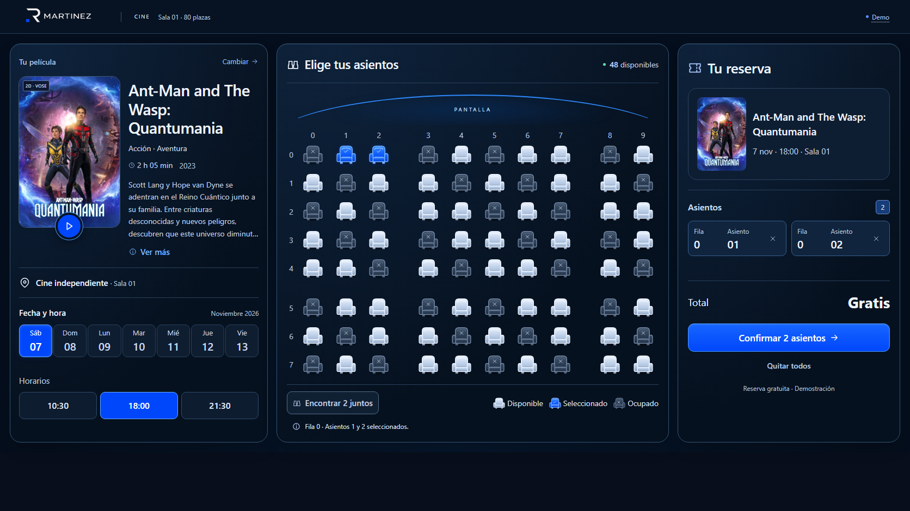
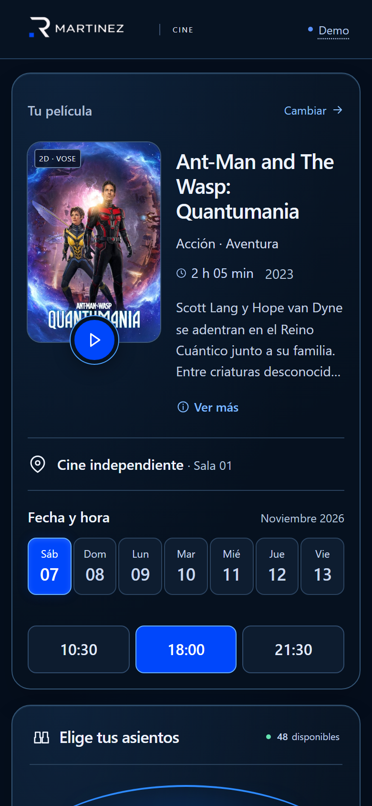
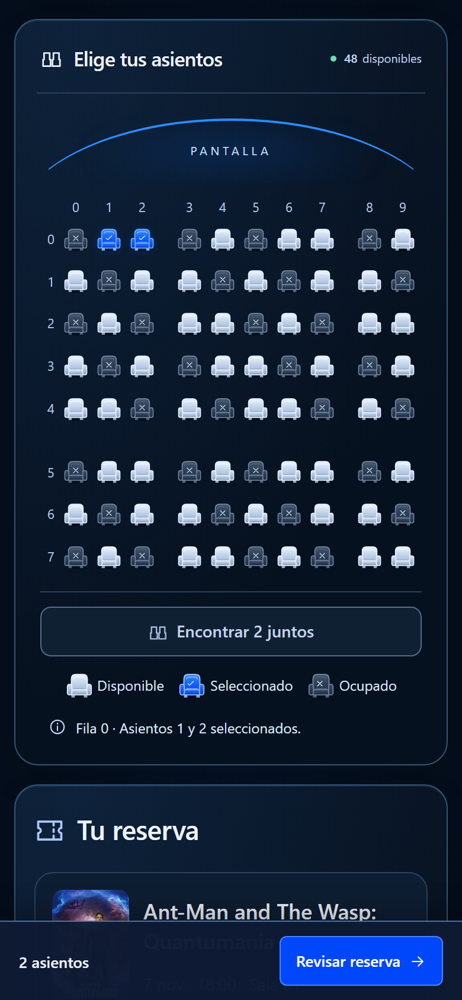
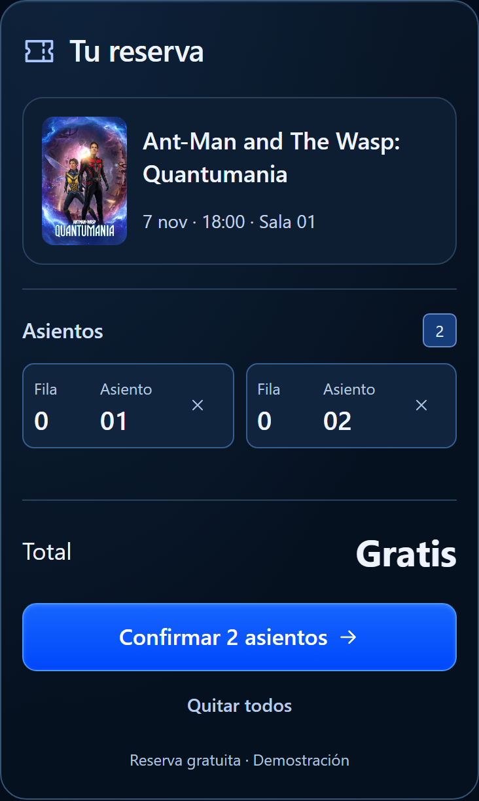

# Cinema Seat Manager

Gestor de reservas de cine desarrollado con **TypeScript**, basado en la plantilla oficial de 4Geeks Academy. Incluye el programa de consola del ejercicio y una interfaz responsive con **HTML y Tailwind CSS** como reto extra.

**80 plazas · Matriz 8 × 10 · Reserva por coordenadas · Búsqueda de asientos contiguos**

## Vista previa

### Escritorio

Ficha de película, mapa completo y reserva en una sola vista.



### Móvil

Película y sesión, elección de butacas y revisión de la reserva. Capturas reales a 390 px de ancho.

<p>
  
  
  
</p>

## Ejecutar el proyecto

Requisitos: **Node.js 22 o superior** y npm.

```sh
git clone https://github.com/rogerdevmtz/cinema-seat-manager.git
cd cinema-seat-manager
npm ci
```

| Comando | Uso |
| --- | --- |
| `npm run console` | Ejecuta los cuatro escenarios del ejercicio en la terminal. |
| `npm run start` | Inicia la web; abre la dirección que indique Vite, normalmente `http://localhost:5173`. |
| `npm test` | Comprueba la lógica, la selección y la generación de entradas. |
| `npm run typecheck` | Valida los tipos de TypeScript. |
| `npm run build` | Genera la web para producción en `dist/`. |
| `npm run preview` | Permite revisar la compilación localmente. Requiere ejecutar `build` antes. |

## Funcionalidad del ejercicio

La sala se representa exclusivamente con una matriz numérica: **0 = disponible**, **1 = ocupado**. Las filas van de 0 a 7 y las columnas de 0 a 9.

| Función | Comportamiento |
| --- | --- |
| `createRoom()` | Inicializa las ocho filas independientes con diez asientos libres cada una. |
| `printRoom(room)` | Imprime `L`/`X` con índices de fila y columna. |
| `reserveSeat(room, row, column)` | Valida las coordenadas y la disponibilidad, reserva y devuelve un mensaje. |
| `countSeats(room)` | Devuelve `[ocupados, disponibles]`. |
| `findAdjacentSeats(room)` | Devuelve el primer par horizontal libre, por fila y columna, o `null`. No modifica la sala. |

La consola demuestra sala vacía, parcialmente ocupada, casi llena con asientos aislados y completamente llena. Las funciones usan arreglos, parámetros tipados, retornos, condicionales y bucles; no se modelan asientos con objetos ni clases.

## Reto extra: reserva visual

1. Elige la película con **Cambiar** y selecciona fecha y horario.
2. Pulsa una butaca libre o **Encontrar 2 juntos**.
3. Revisa las plazas y pulsa **Confirmar**. La selección se convierte entonces en ocupación.
4. Guarda la entrada en SVG o vuelve a consultarla desde **Mi entrada**.

Incluye sinopsis, tráiler bajo demanda, retirada individual de plazas y **Deshacer** al cambiar una sesión con selección pendiente. **Demo** permite cargar los cuatro escenarios. El mapa admite Tab, flechas, Inicio/Fin, Enter y Espacio; los avisos se anuncian a lectores de pantalla.

Los pasillos son espacios visuales después de las columnas 2 y 7 y antes de la fila 5. Conservan las **80 plazas** y la búsqueda por coordenadas del enunciado. La selección pendiente se guarda aparte: la matriz sigue teniendo solo valores 0 y 1.

Es una demostración sin servidor ni pagos. Cada sesión conserva sus reservas durante la visita; recargar reinicia los datos. Las fechas son ilustrativas y las entradas no permiten acceder a un cine real.

## Estructura del proyecto

- [src/cinema.ts](src/cinema.ts): lógica central compartida.
- [src/main.ts](src/main.ts): demostración por consola.
- [src/web.ts](src/web.ts): interfaz y eventos.
- [src/seat-layout.ts](src/seat-layout.ts): validación previa de la selección.
- [src/ticket.ts](src/ticket.ts): entrada SVG; [src/movie-details.ts](src/movie-details.ts): fichas y tráileres.
- [src/style.css](src/style.css) y [src/reference.css](src/reference.css): Tailwind, estilos y adaptación responsive.
- [tests/](tests/): comprobaciones de lógica, selección y entradas.

La [validación del proyecto](VALIDACION.md) relaciona los requisitos y criterios oficiales con el código y las comprobaciones realizadas. La web es el reto opcional; la evaluación se centra en la lógica y la consola.

[Créditos, fuentes y notas de dependencias](docs/CREDITOS.md).
